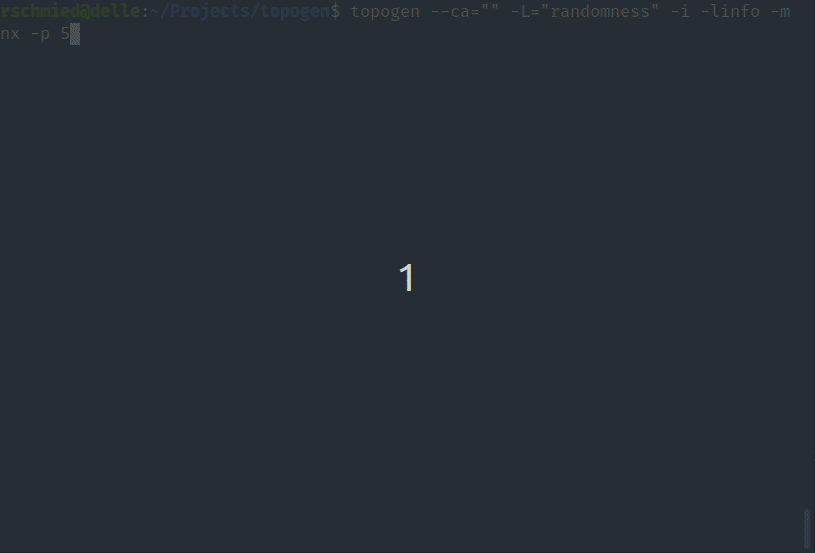

# TopoGen for CML2

This package provides a `topogen` command which writes CML/simple YAML topologies offline.



## Features

- create topologies of arbitrary size (up to 400 tested, this is N^2)
- can use templates to provide node configurations (currently a built-in
  DNS host template and an IOSv template exist)
- provide network numbering for all links (/30) and router loopbacks
- provide a DNS configuration so that all loopbacks and interface addresses can
  be resolved both from the DNS host as well as from all routers (provided the
  template configures DNS)
- provide a default route via DNS host, distributed via OSPF
- provide outbound NAT on the DNS host for the entire network

## Installation

> **Important** TopoGen no longer talks to a live controller. It writes YAML offline and does not need the PCL.

Steps:

1. clone this directory
2. create virtual environment in it `python3 -mvenv .venv`
3. activate the venv `source .venv/bin/activate` (or with
   .fish or .bat, ...)
4. install using `python3 -mpip install -e .`

Alternatively, use Astral/uv:

1. clone this directory
2. create the venv: `uv venv`
3. activate the venv `source .venv/bin/activate` (optional, can also
   run with `uv run`)
4. install using `uv sync --frozen`

If the random graph mode is used, install the extra graph dependencies with:
`uv sync --all-extras --dev --frozen`

At this point, the `topogen` command should be available. Alternatively,
if you did not activate the venv, use `uv run topogen`.

## Configuration

### Tool

The tool accepts a variety of command line switches... they are all listed by
providing `-h` or `--help`:

```plain
$ topogen --help
usage: topogen [-h] [-c CONFIGFILE] [-w] [-v] [-l LOGLEVEL] [--ca CAFILE] [-i] [-d DISTANCE] [-L LABNAME] [-T TEMPLATE]
               [--list-templates] [--output OUTPUT] [-m {nx,simple}]
               [nodes]

generate test topology files and configurations for CML2

positional arguments:
  nodes                 Number of nodes to generate

optional arguments:
  -h, --help            show this help message and exit
  --ca CAFILE           Use the CA certificate from this file (PEM format), defaults to ca.pem
  -i, --insecure        If no CA provided, do not verify TLS (insecure!)
  -d DISTANCE, --distance DISTANCE
                        Node distance, default 200
  -L LABNAME, --labname LABNAME
                        Lab name to create, default "topogen lab"
  -T TEMPLATE, --template TEMPLATE
                        Template name to use, defaults to "iosv"
  --list-templates      List all available templates
  -m {nx,simple}, --mode {nx,simple}
                        mode of operation, default is "simple"

configuration:
  -c CONFIGFILE, --config CONFIGFILE
                        Use the configuration from this file, defaults to config.toml
  -w, --write           Write the default configuration to a file and exit
  -v, --version         show program's version number and exit
  -l LOGLEVEL, --loglevel LOGLEVEL
                        DEBUG, INFO, WARN, ERROR, CRITICAL, defaults to WARN
$
```

At a minimum, the amount of nodes to be created must be provided for the sample generator.

#### Modes

TopoGen writes offline YAML. The default command emits a simple sample topology that can be saved and inspected locally.

#### Templates

To list the available templates, use the `--list-templates` switch. Templates
are provided for IOSv, IOL-XE, and the FRR Docker node from
[`CiscoLearning/cml-docker-containers`](https://github.com/CiscoLearning/cml-docker-containers/tree/main/containers/frr).

Choose a template with `--template`, for example `--template=iosv` or
`--template=frr`. The template name must match the CML node-definition ID.
All router nodes in a generated topology use the selected template.

The FRR node receives its native configuration as `node.cfg`, day-zero commands
as `boot.sh`, and enabled daemon names as `protocols`, as required by the modern
FRR Docker node definition.

#### Other Configuration

IP address ranges are configured via a configuration file, if present.  The
defaults are like shown here:

```toml
loopbacks = "10.0.0.0/8"
p2pnets = "172.16.0.0/12"
nameserver = "8.8.8.8"
domainname = "virl.lab"
username = "cisco"
password = "cisco"
```

The username and password are used for the device configurations (e.g. the
Alpine DNS node and the generated routers).  The nameserver value is not used
at the moment (it is actually replaced with the IP address of the DNS host's
second interface / NIC facing the router network).

## Operation

TopoGen now focuses on offline YAML generation. The sample output still models routers and links, but no live controller is involved.

> [!NOTE]
>
> The sample DNS host installs dnsmasq at boot. Internet access is needed
> for that first boot only. After the topology is up, you can SSH/Telnet to
> the nodes by name.

```plain
rschmied@delle:~/Projects/topogen$ ssh -tp1122 sysuser@192.168.122.245 ssh cisco@192.168.255.100
cisco@192.168.255.100's password: 
Welcome to Alpine!

The Alpine Wiki contains a large amount of how-to guides and general
information about administrating Alpine systems.
See <http://wiki.alpinelinux.org/>.

You can setup the system with the command: setup-alpine

You may change this message by editing /etc/motd.

dns-host:~$ telnet r1
Connected to r1

Entering character mode
Escape character is '^]'.


**************************************************************************
* IOSv is strictly limited to use for evaluation, demonstration and IOS  *
* education. IOSv is provided as-is and is not supported by Cisco's      *
* Technical Advisory Center. Any use or disclosure, in whole or in part, *
* of the IOSv Software or Documentation to any third party for any       *
* purposes is expressly prohibited except as otherwise authorized by     *
* Cisco in writing.                                                      *
**************************************************************************

User Access Verification

Username: cisco
Password: 
**************************************************************************
* IOSv is strictly limited to use for evaluation, demonstration and IOS  *
* education. IOSv is provided as-is and is not supported by Cisco's      *
* Technical Advisory Center. Any use or disclosure, in whole or in part, *
* of the IOSv Software or Documentation to any third party for any       *
* purposes is expressly prohibited except as otherwise authorized by     *
* Cisco in writing.                                                      *
**************************************************************************
R1#traceroute 192.168.122.1
Type escape sequence to abort.
Tracing the route to 192.168.122.1
VRF info: (vrf in name/id, vrf out name/id)
  1 from-r1-gi0-0-to-r9-gi0-0.virl.lab (172.16.0.2) 3 msec
    from-r1-gi0-1-to-r2-gi0-0.virl.lab (172.16.0.6) 9 msec
    from-r1-gi0-2-to-r4-gi0-0.virl.lab (172.16.0.10) 4 msec
  2 from-r7-gi0-4-to-r9-gi0-2.virl.lab (172.16.0.57) 10 msec
    from-r2-gi0-3-to-r7-gi0-0.virl.lab (172.16.0.22) 18 msec
    from-r4-gi0-2-to-r7-gi0-2.virl.lab (172.16.0.38) 14 msec
  3 172.16.0.77 7 msec 10 msec 11 msec
  4 192.168.255.1 11 msec 14 msec 9 msec
  5 192.168.122.1 13 msec 12 msec 11 msec
R1#
```
